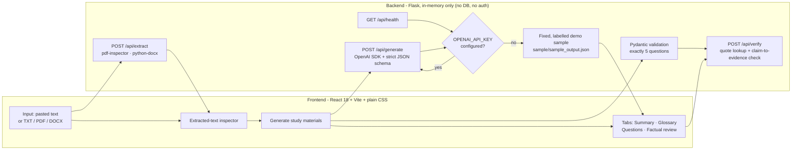

# LectureLens AI — Accessible Lecture Notes and Evidence-Grounded Study Assistant

LectureLens takes instructor-approved lecture notes (pasted text or a **TXT / PDF / DOCX** file) and
produces:

1. a concise **summary** with an exact source quotation behind every bullet,
2. a **glossary** of key terms that refuses to invent definitions the notes do not support,
3. **exactly five practice questions** with an answer key and evidence,
4. a **factual review checklist** for the human reviewer,
5. explicit **warnings** for anything the notes cannot support.

Every generated item carries a grounding status — `SUPPORTED`, `PARTIALLY_SUPPORTED` or
`UNSUPPORTED` — plus the quotation and (when available) the page or section it came from.
A verification pass runs **separately from generation** and checks that each quotation really
exists in the extracted source and that the claim wording overlaps its evidence.

> **Human verification required.** Automated checks reduce risk but never guarantee factual
> accuracy. AI-generated material must be reviewed by a person before academic use.

> **Project status:** live AI generation has **not** been exercised end-to-end yet (no API key was
> available during verification). Everything below was verified on **2026-10-25** in demo mode and
> against the mocked test suite — see [§7 Testing](#7-testing-and-verification-record) and
> [§8 Current Project Status](#8-current-project-status).

**Contents**

1. [Architecture](#1-architecture)
2. [Setup](#2-setup)
3. [Running the application](#3-running-the-application)
4. [API reference](#4-api-reference)
5. [Sample demonstration](#5-sample-demonstration)
6. [Hallucination prevention and its limits](#6-hallucination-prevention-and-its-limits)
7. [Testing and verification record](#7-testing-and-verification-record)
8. [Current Project Status](#8-current-project-status)
9. [Remaining Work and Next Steps](#9-remaining-work-and-next-steps)
10. [Team Responsibilities](#10-team-responsibilities)
11. [GitHub collaboration guide](#11-github-collaboration-guide)
12. [Team progress tracker](#12-team-progress-tracker)
13. [Definition of done](#13-definition-of-done)
14. [Design system](#14-design-system)
15. [Troubleshooting](#15-troubleshooting)
16. [Known limitations](#16-known-limitations)
17. [Deliverables checklist](#17-deliverables-checklist)

---

## 1. Architecture



Design rules kept on purpose: no database, no authentication, no vector store, no deployment
infrastructure. Files are read into memory, extracted, and discarded; nothing is written to disk.

### Repository layout

```
backend/
  app.py                     # Flask app + /api/health, /api/sample, /api/extract, /api/generate, /api/verify
  config.py                  # env-driven configuration (OPENAI_API_KEY, OPENAI_MODEL, limits)
  schemas.py                 # Pydantic models for strict structured output + verification payloads
  services/
    extraction.py            # TXT / PDF / DOCX / pasted text -> segments with page or section
    generation.py            # OpenAI SDK call, strict JSON schema, retry + validation
    verification.py          # quotation lookup + claim-to-evidence check (separate from generation)
    demo_data.py             # loads the bundled, hand-checked sample
  tests/                     # pytest suite (OpenAI is mocked; no paid API calls)
  requirements.txt
frontend/
  index.html  vite.config.js  package.json
  scripts/
    smoke.mjs                # SSR render smoke test of every view (real API data)
    interaction.mjs          # full workflow test in a real DOM against the real API
  src/
    App.jsx                  # session state, navigation, generation flow, layout shell
    api.js                   # API service module (timeouts, normalised errors)
    styles.css               # editorial design system (tokens, layout, components)
    lib/                     # evidence/grounding helpers + text utilities
    components/              # Sidebar, WorkspaceHeader, ContextPanel, Intake,
                             # GroundingBadge, EvidencePassage, SourceViewer,
                             # Checklist, charts (EvidenceCoverage, PracticeProgress),
                             # LoadingStages, EmptyState, ErrorState, Toasts …
    views/                   # Overview, NotesView, ResultsShell, SummaryPanel,
                             # GlossaryPanel, PracticePanel, FactCheckPanel, SettingsView
sample/
  sample_input.txt           # the sample lecture notes
  sample_output.json         # fixed sample output + completed example checklist
docs/
  hallucination-prevention.md  # methods and their limitations
.env.example  README.md  CONTRIBUTING.md  pytest.ini
```

---

## 2. Setup

Prerequisites: **Python 3.9+** (verified on Python 3.9.6) and **Node 18+** (verified on Node
v22.23.3 / npm 10.9.9).

### Backend

```bash
python3 -m venv .venv
source .venv/bin/activate            # Windows: .venv\Scripts\activate
pip install -r backend/requirements.txt
```

### Frontend

```bash
cd frontend
npm ci          # exact versions from package-lock.json (npm install also works)
cd ..           # or: npm ci --prefix frontend
```

### Configuration

```bash
cp .env.example .env
# edit .env and set your own OPENAI_API_KEY (never commit it)
```

The Flask process does not read `.env` by itself; export it into the shell before starting the
server:

```bash
set -a; source .env; set +a
```

`.env` is listed in `.gitignore` and must stay untracked. Each teammate keeps their own local
`.env`; only `.env.example` (with empty values) is committed.

---

## 3. Running the application

Exact commands (run each in its own terminal, from the repository root):

**Terminal 1 — backend (Flask API on port 5001):**

```bash
set -a; source .env; set +a          # optional: loads OPENAI_API_KEY / OPENAI_MODEL
.venv/bin/python -m backend.app      # or: PORT=5001 .venv/bin/python -m backend.app
```

**Terminal 2 — frontend (Vite dev server on port 3000):**

```bash
cd frontend && npm run dev
```

Open <http://localhost:3000>. The Vite dev server proxies `/api` to `http://127.0.0.1:5001`, so the
browser only ever talks to port 3000.

> **Port gotcha:** the backend reads the `PORT` environment variable (default `5001`). If your
> shell already exports `PORT` (some hosting/preview shells do), Flask starts on *that* port and the
> Vite proxy will fail with connection refused. Start it explicitly with `PORT=5001` when in doubt.

If **no API key** is configured, the app still runs: `/api/health` reports
`live_ai_configured: false` (and Settings shows *“not configured — demo mode”*), the session chip
in the header shows **“demo output”**, and generation returns the fixed, clearly labelled sample
from `sample/`. The UI never claims live generation succeeded when the API is unavailable — it
shows *“Demo output — not generated live.”* with an explanation (all three strings verified in the
running app, 2026-10-25).

---

## 4. API reference

All errors use the shape `{"error": {"code", "message", "details"?: [...]}}`.

| Method | Path | Body | Returns |
| ------ | ---- | ---- | ------- |
| `GET` | `/api/health` | – | `status`, `live_ai_configured`, `model`, `demo_mode`, `allowed_file_types`, `limits`. Never contains secrets. |
| `GET` | `/api/sample` | – | The bundled sample lecture notes (`filename`, `text`, `char_count`) — an **input** fixture for the “Load sample lecture” button, never presented as generated output. |
| `POST` | `/api/extract` | multipart `file`, **or** JSON `{"text": "..."}` | `text`, `segments` (`{location, text}` with `Page n` / `Section: …` markers), `char_count`, `locations`, `file_type`, `size_bytes`, `encoding`. |
| `POST` | `/api/generate` | JSON `{"text", "segments"?, "demo"?}` | `mode` (`live` \| `demo`), `model`, `materials` (summary, glossary, 5 questions + answer key), `verification`, `warnings`, `demo_notice`. |
| `POST` | `/api/verify` | JSON `{"source_text", "segments"?, "items"?, "materials"?}` | Per-item report: `evidence[].found`, `actual_location`, `location_match`, `claim_check`, `needs_review`, `reasons`, `reported_grounding` vs `verified_grounding`, plus a summary and the verification disclaimer. |

Validation and error behaviour:

| Situation | Status | Code |
| --------- | ------ | ---- |
| Empty / missing text, malformed JSON, bad segments | 400 | `invalid_input`, `invalid_json`, `invalid_segments` |
| Unsupported file type, empty file, malformed PDF/DOCX, no extractable text | 400 | `unsupported_file_type`, `empty_file`, `malformed_document`, `no_text_found` |
| Wrong content type | 415 | `unsupported_media_type` |
| File or text over the configured limit | 413 | `file_too_large`, `text_too_long` |
| No API key when live generation is required | 503 | `missing_api_key` |
| OpenAI rate limit | 429 | `rate_limit` |
| OpenAI auth failure | 503 | `auth_error` |
| OpenAI unreachable / API error | 502 | `api_unavailable`, `api_error` |
| Model returned invalid JSON, failed schema validation, or not exactly 5 questions | 502 | `invalid_response`, `question_count` |

---

## 5. Sample demonstration

`sample/sample_input.txt` contains the sample lecture notes; `sample/sample_output.json` contains a
**hand-checked** sample output (it was *not* produced by a live model run):

- 5 summary bullets, each with an exact quotation,
- 8 glossary entries covering process scheduling, ready queue, FCFS, SJF, Round Robin, context
  switch, time quantum — plus **turnaround time**, whose definition is marked
  **“Not supported by source”**,
- exactly 5 practice questions (recall, conceptual and application) with answers and evidence,
- one deliberately unsupported claim — *“Round Robin gives the lowest average waiting time”* —
  flagged `UNSUPPORTED` with an explanation even though its quotation exists in the notes,
- one partially supported answer key entry (question 5),
- a completed example factual review checklist, with the human-review item intentionally pending.

Run the backend without an API key and press **Create study materials** to see this output in the
UI, labelled as demo mode. The verification report you see is computed live by the verification
service against the sample source — it is not pre-baked.

---

## 6. Hallucination prevention and its limits

Full write-up: [`docs/hallucination-prevention.md`](docs/hallucination-prevention.md). Summary:

1. The supplied notes are the **only** factual authority; the prompt forbids outside knowledge.
2. Every item must return a **verbatim quotation** plus a page/section marker, and a grounding
   status with a warning when unsupported.
3. Pydantic validates the model's JSON; the question count must be exactly 5 (one corrective
   retry, then a clear 502 error).
4. **Quote check** — every quotation is located in the extracted source after careful whitespace
   normalisation; unmatched or location-mismatched citations are flagged, never accepted.
5. **Claim-to-evidence check** — a separate lexical-overlap test; a quote that exists is *not*
   treated as proof that the claim is entailed.
6. Grounding status can only be **kept or downgraded**, never upgraded, by verification.
7. Uncertain items are flagged `needs_review` with human-readable reasons and shown in the UI.
8. Missing API key ⇒ labelled demo mode; API failures surface as explicit errors instead of
   pretending to be live output.

---

## 7. Testing and verification record

### Commands

```bash
# Backend — 63 tests, OpenAI mocked, no paid calls
.venv/bin/python -m pytest

# Frontend production build
npm run build --prefix frontend

# Frontend render smoke test — every view rendered with real API data (backend on :5001)
npm run smoke --prefix frontend

# Frontend interaction test — real DOM + real API, drives the whole workflow
# (needs :5001 Flask and :3000 Vite running)
npm run test:dom --prefix frontend
```

### Recorded results — 2026-10-25, macOS, Python 3.9.6, Node v22.23.3, npm 10.9.9

| Check | Command | Result |
| ----- | ------- | ------ |
| Clean install (backend) | `python3 -m venv .venv` + `pip install -r backend/requirements.txt` | **Passed** — all dependencies resolved |
| Backend test suite | `python -m pytest` | **63 passed** (extract 17, generate 21, health 6, verify 19), exit 0. 5 third-party `DeprecationWarning`s from PyMuPDF's SWIG bindings — not failures. |
| Clean install (frontend) | `npm ci` | **Passed** (lockfile install; npm audit notes apply to dev tooling) |
| Production build | `npm run build --prefix frontend` | **Passed** — 59 modules; `index.html` 1.00 kB, CSS 27.21 kB, JS 211.59 kB |
| Render smoke test | `npm run smoke --prefix frontend` | **12 passed, 0 failed**, exit 0 |
| Interaction test | `npm run test:dom --prefix frontend` | **40 passed, 0 failed, 0 page errors**, exit 0 |
| Health endpoint (live) | `curl /api/health` | `status: ok`, `demo_mode: true`, `live_ai_configured: false`, limits 5 MB / 60,000 chars, model `gpt-4o-mini` |
| TXT extraction (live) | `curl -F file=@sample/sample_input.txt /api/extract` | Extracted 542 chars with segment locations |
| Demo generation (live) | `curl POST /api/generate` | `mode: demo` — 5 summary bullets, 8 glossary entries, exactly 5 questions, verification report + example checklist returned |
| Unsupported upload (live) | `curl -F file=@f.bin /api/extract` | `400 unsupported_file_type` with a clear message |
| Browser workflow (demo) | Real browser at `localhost:3000`, 2026-10-25 | Load sample → generate → **“Demo output — not generated live.”** banner → tabs Summary 5 / Glossary 8 / Practice 5 / Fact check 23 → unsupported bullet flagged with explanation and “Needs human review” → “Evidence matched — semantic support not verified” wording → practice reveal/flag controls → fact-check filters → all 8 checklist checkboxes toggle (counter 0→1) → donut chart with text alternative → **no console errors** |
| Responsive spot check | 390 × 844 viewport | Layout stacks correctly, navigation collapses to a menu; tab strip clips at this width (cosmetic — tracked as P1-07) |
| Secret scan (working tree) | Regex scan for `sk-…` / assigned API keys | **No matches**; `.env` absent; `.env.example` present and empty |
| **Live OpenAI generation** | – | **NOT RUN — blocked:** no `OPENAI_API_KEY` available in this environment. See P0-06. |

The two frontend suites are dependency-light (SSR render + jsdom) and need no browser automation
framework, so they run anywhere Node runs.

**Interaction test coverage:** sample load → staged generation → results tabs → evidence drawer
highlight → glossary search/flashcards/mark-revised → practice reveal/navigate/flag/restart →
fact-check filters → chart→filter pipeline → checklist → navigation → upload rejection → API
failure with retry and input preservation.

**Backend coverage:** pasted-text generation, TXT/PDF/DOCX extraction (files built in memory), the
exactly-five-questions rule, evidence quotations missing from the source, unsupported and partially
supported items, invalid/empty inputs, malformed AI responses, missing API key and API error mapping
(rate limit, auth, connection), file-upload restrictions, the health endpoint and the
sample-notes endpoint.

> No test passed that was not actually executed. Where a check could not run (live AI), the blocker
> and its fix are recorded above and in P0-06.

---

## 8. Current Project Status

Statuses used: `Tested — passing` · `Implemented — unverified` · `Partially implemented` ·
`Not implemented` · `Blocked`. All evidence below was observed on **2026-10-25** (see §7).

| Feature/Component | Current Status | Evidence/Location | Remaining Work |
| --- | --- | --- | --- |
| React frontend and responsive UI | Tested — passing | `frontend/src/`; build ✓, smoke 12/12, DOM 40/40, browser walkthrough ✓; 390 px spot check ✓ | Full breakpoint/keyboard/screen-reader pass (P1-01); tab-strip overflow at 390 px (P1-07) |
| Pasted-text input and TXT/PDF/DOCX upload | Tested — passing | `backend/tests/test_extract.py` (17 tests, files built in memory); TXT upload verified live; paste + sample-load verified in browser | Exercise with representative real-world PDF/DOCX files (P1-02) |
| Document extraction and input validation | Tested — passing | `backend/services/extraction.py`; live checks: unsupported type → `400 unsupported_file_type`; limits 5 MB / 60,000 chars enforced and unit-tested | None known; extend if P1-02 finds edge cases |
| Flask API endpoints (health/sample/extract/generate/verify) | Tested — passing | `backend/app.py`; all 5 routes exercised live or via tests (health, sample, extract, generate verified live; verify covered by 19 tests + demo run) | None known |
| OpenAI integration and configuration | Blocked | `backend/config.py`, `backend/services/generation.py` (`OPENAI_API_KEY`, `OPENAI_MODEL`, default `gpt-4o-mini`); mocked path covered by 21 tests | **Live end-to-end run with a real key (P0-06)** — no key available in this environment |
| Summary generation with source evidence | Tested — passing (demo + mocked paths) | Demo run in browser: 5 bullets each with evidence and status; `test_generate.py` mocked-live tests | Confirm live-model quality once a key exists (P0-06) |
| Glossary generation and unsupported definitions | Tested — passing (demo + mocked paths) | Demo run: 8 entries, “Not supported by source” rendering verified; schema `definition: null` + `UNSUPPORTED` rules in `schemas.py` / prompt | Same as above (P0-06) |
| Exactly five practice questions and answer key | Tested — passing | `schemas.py` (count validation), `generation.py` (1 corrective retry then `question_count` 502), `test_exactly_five_questions_required`; UI shows “Question 1 of 5” | None |
| Source quotation + claim-to-evidence verification | Tested — passing | `backend/services/verification.py`; 19 tests; demo run located 27/27 quotes and flagged 6 items for review | Semantic-entailment checking stays out of scope by design (documented limitation) |
| Grounding labels and human-review checklist | Tested — passing | `GroundingBadge.jsx`, `Checklist.jsx`; browser: 8 checklist items toggle and count, `UNSUPPORTED` bullet shows warning + reasons | Human-review workflow rehearsed in demo (P2-01) |
| Demo mode and API error handling | Tested — passing | Demo banner observed in browser; error codes mapped in unit tests (rate limit/auth/connection/invalid response); live probe: unsupported file rejected | Live failure modes (real 429/auth) only reachable with a key (P0-06) |
| Interactive study features, charts, navigation | Tested — passing | Tabs, filters, donut chart (text alternative observed), practice reveal/flag/restart, glossary flashcards — covered by the 40-check interaction test and browser walk-through; console clean | Manual UX/a11y review (P1-01, P1-03) |
| Backend unit tests | Tested — passing | `backend/tests/` — **63 passed**, exit 0 (2026-10-25) | Expand for gaps found in review (P1-05) |
| Frontend smoke and interaction tests | Tested — passing | `frontend/scripts/` — **12/12** and **40/40**, exit 0 (2026-10-25) | Add fast unit tests for `src/lib/` (P1-04) |
| Sample input/output | Tested — passing | `sample/sample_input.txt`, `sample/sample_output.json`; served through `/api/sample` and demo generation; matches the spec (5 bullets, 8 terms, 5 questions, ≥1 flagged unsupported, completed checklist) | Final spec cross-check before submission (P2-02) |
| README and project documentation | Partially implemented | This README + `docs/hallucination-prevention.md` + `CONTRIBUTING.md`; all commands and counts re-verified 2026-10-25 | Team review of accuracy; screenshots if useful (P2-03); final doc pass (P2-04) |
| CI pipeline (GitHub Actions) | Not implemented | No `.github/workflows/` exists | Add CI running pytest + build + smoke + DOM tests (P1-08) |
| GitHub readiness and secret protection | Tested — passing | Repository published: **github.com/HoneyWadwa/ClariNote**, HEAD `e0b77f7`, 61 tracked files (2026-10-25). `.gitignore` covers `.env`, `.venv/`, `node_modules/`, `dist/`; `.env.example` values empty; audit of tracked files found no forbidden files and no key patterns | Exercise the branch → PR → review flow on real tasks (P1-08 CI); final tracked-file audit at P2-04 |
| Live OpenAI end-to-end run | Blocked | `/api/health` reports `live_ai_configured: false` | Set a real key in a local `.env` and run P0-06; never commit the key |

---

## 9. Remaining Work and Next Steps

Candidate tasks from the project brief, reviewed against the code: items that were already verified
are recorded as complete with their evidence. Statuses are mirrored in the
[progress tracker](#12-team-progress-tracker).

### P0 — Must complete before the final demonstration

| ID | Description | Owner | Dependencies | Acceptance criteria | Status |
| -- | ----------- | ----- | ------------ | ------------------- | ------ |
| P0-01 | Verify installation from a clean environment | Person 1 | – | Fresh clone installs backend + frontend from lockfiles without errors | - [x] **Done** — fresh `.venv` + `pip install -r` and `npm ci` both succeeded 2026-10-25 |
| P0-02 | Run all backend tests and record the actual result | Person 3 | P0-01 | Command, date and result recorded in §7 | - [x] **Done** — `pytest`: **63 passed**, exit 0 |
| P0-03 | Run the frontend production build | Person 2 | P0-01 | Build completes; output sizes recorded | - [x] **Done** — `vite build` succeeded (59 modules) |
| P0-04 | Run the frontend smoke and interaction tests | Person 2 | P0-03, backend on :5001, Vite on :3000 | Both suites report 0 failures with exit 0 | - [x] **Done** — smoke **12/12**, interaction **40/40**, 0 page errors |
| P0-05 | Start frontend + backend and test the complete user workflow | Person 1 | P0-04 | Sample → generate → all four tabs → evidence → checklist observed in a browser | - [x] **Done** — demo workflow walked through in a real browser, console clean (§7) |
| P0-06 | Test **live** OpenAI mode (demo mode already verified) | Person 3 | A real API key in a local `.env` | `/api/health` → `live_ai_configured: true`; generate returns `mode: live`; exactly 5 questions; quotes located by `/api/verify`; record output in the PR/issue | - [ ] **Blocked** — no API key in the verification environment. *Resolve by:* teammate adds their key to local `.env` (never committed), restarts Flask, runs the flow once and pastes the (redacted) result here |
| P0-07 | Test upload errors, empty input, unsupported content, API failures | Person 3 | P0-01 | Each case returns the documented status/code; UI shows a readable message | - [x] **Done** for covered cases — unit tests for empty/oversized/malformed/unsupported inputs, live probe returned `400 unsupported_file_type`, interaction test covers API failure + retry + input preservation. Extend with teammates' own files (P1-02) |
| P0-08 | Fix any reproducible bugs found | Person 1 → route to owner | P0-05, P0-07 | Each bug fixed with a regression check | - [x] **No reproducible bugs found** in the 2026-10-25 run; one cosmetic issue logged as P1-07 |
| P0-09 | Verify claims/quotations are displayed honestly and unsupported content is flagged | Person 1 | P0-05 | Demo banner, “semantic support not verified” wording, `UNSUPPORTED` warnings and needs-review reasons all visible | - [x] **Done** — all four observed in the browser (§7) |
| P0-10 | Check that no API keys, `.env` files, credentials or personal information are committed | Person 1 | P0-11 | `git ls-files` contains no secrets; scan recorded | - [x] **Done** — working tree *and* the 61 tracked files audited after the first push: no `.env`, no `.venv`/`node_modules`/`dist`, no key patterns (2026-10-25) |
| P0-11 | Initialize the GitHub repository and push the first commit | Person 1 | P0-10 | Repo contains source only; `.env.example` present; README renders on GitHub | - [x] **Done** — `HoneyWadwa/ClariNote` published 2026-10-25 (`bb79326..e0b77f7`), 61 tracked files, README renders |

### P1 — Improve reliability and usability

| ID | Description | Owner | Dependencies | Acceptance criteria | Status |
| -- | ----------- | ----- | ------------ | ------------------- | ------ |
| P1-01 | Check responsive layouts and accessibility (all breakpoints, keyboard-only path, contrast, one screen-reader pass) | Person 2 | P0-05 | Findings documented; blockers fixed; note recorded in this README or an issue | - [ ] Not started (390 px spot check already passed, §7) |
| P1-02 | Test PDF and DOCX extraction using representative real files (multi-page, headings, tables, scanned) | Person 3 | P0-11 | Each file extracts with correct page/section markers or a clear, correct error; failures logged | - [ ] Not started |
| P1-03 | Review evidence display, source locations, glossary flashcards, practice controls and checklist interactions by hand | Person 2 | P0-04 | Interaction walkthrough completed; UX issues filed with severity | - [ ] Not started (automated coverage exists; manual review open) |
| P1-04 | Add unit tests for untested frontend logic (`src/lib/evidence.js`, `src/lib/text.js`) | Person 2 | P0-04 | Tests run with one documented command; cover bucket classification and quote location | - [ ] Not started |
| P1-05 | Expand backend tests where review finds gaps | Person 3 | P0-02 | New tests fail before/fix after; suite stays green | - [ ] Not started |
| P1-06 | Improve error messages and setup instructions where the review finds them unclear | Person 2 (UI) / Person 3 (API) — split by layer | P1-01, P1-02 | Each unclear message updated with a note in the PR; README troubleshooting updated if setup-related | - [ ] Not started |
| P1-07 | Fix tab-strip clipping at ~390 px (labels cut off at the right edge) | Person 2 | – | All four tabs readable/scrollable at 390 px width | - [ ] Not started (found 2026-10-25) |
| P1-08 | Add CI (GitHub Actions): pytest + build + smoke + interaction tests on every PR | Person 1 | P0-11 | Workflow green on a test PR; required check documented in CONTRIBUTING.md | - [ ] Not started |

### P2 — Final delivery

| ID | Description | Owner | Dependencies | Acceptance criteria | Status |
| -- | ----------- | ----- | ------------ | ------------------- | ------ |
| P2-01 | Prepare a clear demonstration workflow (scripted click-path, talking points, limits to mention) | Person 1 | P0-05, P0-06 | A teammate can run the demo from the script alone | - [ ] Not started |
| P2-02 | Finalize sample input/output and the factual review checklist against the problem statement | Person 3 | P0-06 | Every spec bullet in §5 confirmed or corrected | - [ ] Not started |
| P2-03 | Add screenshots only if useful, captured from the actual running application | Person 2 | P0-05 | Images generated from the live app (never mocked); captions state demo vs live | - [ ] Not started (optional) |
| P2-04 | Verify repository cleanliness and final documentation | Person 1 | P1-08, P2-01 | Tracked-file secret scan clean; README re-read for stale claims; deliverables checklist (§17) complete | - [ ] Not started |

---

## 10. Team Responsibilities

Three people, no overlapping ownership. Replace the placeholder names when you add people.
If a task here conflicts with the IDs in §9, the §9 ID wins — this section explains *who* owns them.

### Person 1 — Me: Integration and release coordination

Owns: **P0-01, P0-05, P0-08, P0-09, P0-10, P0-11, P1-08, P2-01, P2-04** (and triages bugs found by
the others).

- Maintain the main GitHub issue/task tracker — one issue per task ID from §9.
- Coordinate integration across branches; keep `main` green.
- Verify the end-to-end workflow after each merge (rerun §7 commands).
- Check README accuracy and submission requirements.
- Review pull requests and run final regression tests before merging.
- Prepare the final demonstration and explain the project architecture and limitations.

### Person 2 — Teammate 1: Frontend and user experience

Owns: **P0-03, P0-04, P1-01, P1-03, P1-04, P1-07, P2-03** (and UI half of P1-06).

- Inspect `frontend/src/` — start with `App.jsx` (session state), `lib/evidence.js` (grounding
  buckets), then `views/` and `components/`.
- Fix frontend bugs and incomplete interactions.
- Verify navigation, upload/paste workflow, results tabs, evidence viewer, glossary, practice
  questions, charts and checklist.
- Check responsive design, keyboard accessibility, and error/loading states.
- Run the production build and both frontend test suites; paste the results into the PR.
- Document any remaining UI issues in the tracker.

### Person 3 — Teammate 2: Backend, AI, and verification

Owns: **P0-02, P0-06, P0-07, P1-02, P1-05, P2-02** (and API half of P1-06).

- Inspect `backend/` — start with `app.py` (routes/error mapping), `services/generation.py`
  (prompt + schema + retry), `services/verification.py` (quote lookup + claim check).
- Verify Flask endpoints and document extraction.
- Test OpenAI configuration, generation, schema validation and exactly-five-question enforcement —
  including the first real live run (P0-06).
- Test evidence verification and unsupported-content handling.
- Run and expand backend tests where necessary.
- Check error handling, input limits, and safe handling of API credentials (never log or return the
  key; `/api/health` must stay secret-free).

**Why this split:** the codebase divides cleanly along the same line — `frontend/` has no Python,
`backend/` has no React — so ownership is unambiguous and PR review crosses exactly one boundary.
P1-06 is the only shared task and is explicitly split by layer to avoid duplicate work.

**Backup tasks if you finish early**

- Person 1: draft the demo script (start of P2-01), set up the issue templates.
- Person 2: capture demo screenshots (P2-03), run a keyboard-only pass (P1-01).
- Person 3: collect and test real-world PDF/DOCX fixtures (P1-02), draft CI matrix (P1-08).

---

## 11. GitHub collaboration guide

Detailed step-by-step Git procedures, conflict walkthroughs and the PR checklist live in
[`CONTRIBUTING.md`](CONTRIBUTING.md). The short version:

### 1. Create the shared repository

**The repository already exists:** <https://github.com/HoneyWadwa/ClariNote> (created and pushed
2026-10-25 — task P0-11). The steps below are kept as the reference procedure for a fresh copy or
a fork: create an empty repository on GitHub (no README, no `.gitignore` — ours exist).

### 2. Upload the project (first time only) — source only

```bash
# from the repository root, with .venv/, frontend/node_modules/, frontend/dist/ present but IGNORED
git init -b main
git add .gitignore .env.example README.md CONTRIBUTING.md pytest.ini \
        backend frontend sample docs
git status                      # review EVERY file below before committing
git ls-files | grep -E '(^|/)(\.env$|\.venv/|node_modules/|dist/|__pycache__/)'   # must print NOTHING
git commit -m "Initial commit: LectureLens AI"
git remote add origin https://github.com/HoneyWadwa/ClariNote.git
git push -u origin main
```

Never use `git add -A` for the first commit; add the directories explicitly.

### 3. Confirm `.gitignore` covers generated files

Our `.gitignore` already lists `.env`, `.env.local`, `.venv/`, `venv/`, `node_modules/`, `dist/`,
`frontend/dist/`, `__pycache__/`, `*.pyc`, `.pytest_cache/`, `.DS_Store`, `*.log`. Verify with:

```bash
git check-ignore -v .env .venv frontend/node_modules frontend/dist
```

Each path must be matched by a rule.

### 4. Keep `.env.example`, never real credentials

`.env.example` stays in the repo with **empty** values. Every teammate copies it locally:

```bash
cp .env.example .env            # then edit .env with your own key
```

`.env` is ignored — **never** commit it, never paste a key into an issue, PR, README or screenshot.

### 5. Clone and set up

```bash
git clone https://github.com/HoneyWadwa/ClariNote.git
cd ClariNote
python3 -m venv .venv && source .venv/bin/activate
pip install -r backend/requirements.txt
npm ci --prefix frontend
cp .env.example .env            # add your own OPENAI_API_KEY (optional — demo mode works without it)
```

### 6. One branch per task

```bash
git switch main && git pull origin main     # always start from an up-to-date main
git switch -c fix/tab-strip-overflow        # or feature/…, test/…, docs/…
```

Name branches after the task ID: `p1-07-tab-strip-overflow`.

### 7. Commit small, meaningful changes

```bash
git add frontend/src/views/ResultsShell.jsx
git commit -m "P1-07: keep the results tab strip scrollable at 390px"
```

One concern per commit; message states the task ID and the reason.

### 8. Push and open a pull request

```bash
git push -u origin p1-07-tab-strip-overflow
```

Open the PR from the GitHub UI; link the task ID (`Closes #12`) and paste your test results.

### 9. Review and test before merging into `main`

The reviewer reruns the relevant §7 commands; CI (once P1-08 lands) runs them automatically. No
merge without a green review.

### 10. Pull before starting new work

```bash
git switch main && git pull origin main
```

If your branch is behind: `git pull --rebase origin main` on your own branch only.

### 11. Resolve conflicts without overwriting anyone's work

```bash
git pull --rebase origin main          # or: git merge origin main
git status                             # lists conflicted files
# open each file: choose the correct lines, delete the <<<<<<< / ======= / >>>>>>> markers
git add <resolved-file>
git commit                             # rebase: git rebase --continue
git push
```

Never `git checkout --theirs -- <file>` to "solve" a conflict, never force-push a shared branch,
never commit a teammate's file while reverting it to your version. When in doubt, ask the owner of
the conflicting change in the issue thread.

---

## 12. Team progress tracker

Update this table directly in GitHub (one row per task from §9). Status values:
`Not started` · `In progress` · `Blocked` · `Done`.

| Task ID | Task | Owner | Priority | Status | PR / Issue | Testing evidence |
| ------- | ---- | ----- | -------- | ------ | ---------- | ---------------- |
| P0-01 | Verify clean-environment install | Person 1 | P0 | Done | — | Fresh `.venv` + `npm ci`, 2026-10-25 |
| P0-02 | Run backend tests, record result | Person 3 | P0 | Done | — | `pytest`: 63 passed, exit 0 |
| P0-03 | Frontend production build | Person 2 | P0 | Done | — | `vite build` OK, 59 modules |
| P0-04 | Smoke + interaction tests | Person 2 | P0 | Done | — | 12/12 and 40/40, 0 page errors |
| P0-05 | Full user workflow in browser | Person 1 | P0 | Done | — | Walkthrough 2026-10-25, console clean |
| P0-06 | Live OpenAI mode test | Person 3 | P0 | **Blocked** | — | Needs API key (local `.env`) |
| P0-07 | Upload/empty/unsupported/API-failure cases | Person 3 | P0 | Done | — | Unit tests + live `400 unsupported_file_type` + interaction test |
| P0-08 | Fix reproducible bugs | Person 1 | P0 | Done | — | None found; P1-07 logged as cosmetic |
| P0-09 | Honest display + unsupported flagging | Person 1 | P0 | Done | — | Browser observations, §7 |
| P0-10 | No secrets committed | Person 1 | P0 | Done | — | Tree + 61 tracked files scanned after push: no matches |
| P0-11 | Create GitHub repo, first push | Person 1 | P0 | Done | [HoneyWadwa/ClariNote](https://github.com/HoneyWadwa/ClariNote) | Push `bb79326..e0b77f7`, 2026-10-25 |
| P1-01 | Responsive + accessibility pass | Person 2 | P1 | Not started | — | 390 px spot check passed |
| P1-02 | Real-world PDF/DOCX extraction | Person 3 | P1 | Not started | — | — |
| P1-03 | Manual UX review of evidence/flashcards/practice/checklist | Person 2 | P1 | Not started | — | — |
| P1-04 | Frontend unit tests for `src/lib/` | Person 2 | P1 | Not started | — | — |
| P1-05 | Backend test expansion | Person 3 | P1 | Not started | — | — |
| P1-06 | Error-message and setup-doc improvements | Person 2 (UI) / Person 3 (API) | P1 | Not started | — | — |
| P1-07 | Fix tab-strip clipping at 390 px | Person 2 | P1 | Not started | — | Found 2026-10-25 (screenshot in §7 notes) |
| P1-08 | GitHub Actions CI | Person 1 | P1 | Not started | — | — |
| P2-01 | Demo workflow + talking points | Person 1 | P2 | Not started | — | — |
| P2-02 | Finalize sample output vs spec | Person 3 | P2 | Not started | — | — |
| P2-03 | Screenshots from the live app (optional) | Person 2 | P2 | Not started | — | — |
| P2-04 | Final repo cleanliness + doc review | Person 1 | P2 | Not started | — | — |

---

## 13. Definition of done

A task is only `Done` when **all** of the following hold:

1. **Acceptance criteria met** — every line of its row in §9 is satisfied.
2. **Tests run and results recorded** — the exact command, date and output summary appear in the
   PR, issue, or §7 of this README. "Should pass" is not evidence.
3. **Reviewed** — a teammate has read the change. (For verification-only tasks with no code
   change, "reviewed" means a second teammate confirms the recorded evidence.)
4. **Documentation updated if necessary** — user-visible behaviour changes are reflected in
   `README.md` or `CONTRIBUTING.md`.
5. **No regressions** — the change integrates without breaking existing features; the §7 command
   set still passes.

**The project is not submission-ready** until every P0 task is `Done`. As of 2026-10-25 the
remaining critical task is **P0-06** (live AI run), which must either pass or be explicitly
documented as unavailable with its blocker. P0-11 (repository published) is complete.

---

## 14. Design system

| Role | Colour |
| ---- | ------ |
| Page background | warm ivory `#F7F5EF` |
| Primary surface | paper white `#FFFDF8` |
| Text | deep ink `#252922` · secondary `#73766E` |
| Primary accent | forest green `#315C46` |
| Secondary accent | muted terracotta `#C66B4E` (text tone `#9C4A30`) |
| Supporting accent | muted mustard `#D6B65D` (text tone `#6F5312`) |
| Borders | soft warm gray `#E5E1D7` |
| Status | supported `#264C3A` on `#E7EFE9` · warning `#6F5312` on `#F7EFD9` · unsupported `#8A3D28` on `#F8EBE5` |

Typography: **DM Serif Display** for page and section headings, **DM Sans** for body/controls/data
(loaded from Google Fonts with Georgia/system-ui fallbacks), and the system monospace stack for
page numbers, evidence references and metadata. Status is always glyph **plus** text — never colour
alone. Rounded corners stay modest (5–7 px), shadows are restrained, and transitions respect
`prefers-reduced-motion`.

---

## 15. Troubleshooting

| Symptom | Fix |
| ------- | --- |
| UI shows “Backend unreachable” | Start the API: `.venv/bin/python -m backend.app`. Check `curl http://127.0.0.1:5001/api/health`. |
| UI stuck on “Generating…” / proxy errors | Both processes must run: Flask on **5001**, Vite on **3000**. The proxy is defined in `frontend/vite.config.js`. |
| Backend starts but proxy 500s | `PORT` is set in your shell — start with `PORT=5001 .venv/bin/python -m backend.app` (see §3). |
| `live_ai_configured: false` but you set a key | Export it into the shell (`set -a; source .env; set +a`) *before* starting Flask, then restart Flask. |
| `auth_error` (503) | The key is invalid or revoked — create a new one and restart the backend. |
| `rate_limit` (429) | Wait a moment and retry; reduce how often you press Generate. |
| `api_unavailable` (502) | No network access to the AI provider from this machine. Demo mode still works. |
| `no_text_found` on a PDF | The PDF may be scanned or contain no selectable text. Local OCR is not enabled yet; paste the text instead. |
| `unsupported_file_type` | Only `.txt`, `.pdf`, `.docx` are accepted (configurable in `backend/services/extraction.py`). |
| File rejected as too large | Raise `MAX_FILE_MB` in `.env` (default 5 MB) and restart the backend. |
| Preview URL returns 403 | The Vite host allow-list lives in `frontend/vite.config.js` (`allowedHosts`). |
| `pytest: command not found` | Use the virtualenv interpreter: `.venv/bin/python -m pytest` from the repository root. |
| `npm run test:dom` fails immediately | It needs the backend on **:5001** *and* Vite on **:3000**; start both first. |
| Git refuses a file "ignored by .gitignore" | That is intentional for `.env`/`.venv`/`node_modules`; if a source file is wrongly ignored, fix `.gitignore` — do not force-add secrets. |

---

## 16. Known limitations

- **Verification is mechanical, not semantic.** It proves that a quotation exists in the source and
  that the claim's wording overlaps it; it cannot prove the claim is entailed. Every item is
  therefore still marked for human review where any doubt exists.
- **Live generation has not been exercised yet.** No API key was available during verification, so
  the OpenAI path is covered by mocked tests only (P0-06 open).
- **Local OCR is not enabled yet.** `pdf-inspector` reports pages that may need OCR; ClariNote warns when such pages were omitted, and rejects PDFs with no readable text. The package has selective OCR support, but its Windows OCR runtime is still preview, so it needs separate integration and validation.
- **DOCX tables** are only read when the document contains no paragraphs; table-heavy files should
  be converted to TXT/PDF first.
- **Live generation quality depends on the model.** Quotes that the model paraphrases are flagged,
  not silently repaired, so a strict model may produce more `needs_review` items.
- **No persistence.** Refreshing or resetting clears the session by design; uploads are never
  stored.
- **Demo mode is not live output.** Without an API key the app serves the fixed sample and labels
  it as such; it never fabricates a live result.
- **Rate limits and cost** of the OpenAI API apply to live generation; the test suite makes no paid
  calls.
- **No CI yet** — tests must be run manually until P1-08 lands.

---

## 17. Deliverables checklist

1. Frontend source — `frontend/`
2. Flask backend — `backend/`
3. `backend/requirements.txt` and `frontend/package.json` (+ `package-lock.json`)
4. `.env.example` (no credentials)
5. This `README.md` (setup, execution, configuration, status, tasks, team process, troubleshooting)
6. `CONTRIBUTING.md` (detailed GitHub workflow)
7. Complete sample input/output — `sample/`
8. Factual review checklist — UI section D + `checklist_example` in `sample/sample_output.json`
9. Hallucination-prevention explanation — `docs/hallucination-prevention.md`
10. Automated backend tests — `backend/tests/` (**63 passing**, recorded 2026-10-25)
11. Frontend test scripts — `frontend/scripts/` (**12 smoke + 40 interaction checks**, recorded
    2026-10-25)
12. Mermaid architecture diagram — section 1 above
