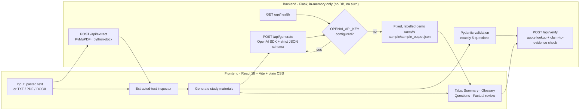

# LectureLens AI — Accessible Lecture Notes and Evidence-Grounded Study Assistant

LectureLens takes instructor-approved lecture notes (pasted text or a **TXT / PDF / DOCX** file) and
produces:

1. a concise **summary** with an exact source quotation behind every bullet,
2. a **glossary** of key terms that refuses to invent definitions the notes do not support,
3. **exactly five practice questions** with an answer key and evidence,
4. a **factual review checklist** for the human reviewer,
5. explicit **warnings** for anything the notes cannot support.

Every generated item carries a grounding status — `SUPPORTED`, `PARTIALLY_SUPPORTED` or
`UNSUPPORTED` — plus the quotation and (when available) the page or section it came from.
A verification pass runs **separately from generation** and checks that each quotation really
exists in the extracted source and that the claim wording overlaps its evidence.

> **Human verification required.** Automated checks reduce risk but never guarantee factual
> accuracy. AI-generated material must be reviewed by a person before academic use.

---

## 1. Architecture



Design rules kept on purpose: no database, no authentication, no vector store, no deployment
infrastructure. Files are read into memory, extracted, and discarded; nothing is written to disk.

### Repository layout

```
backend/
  app.py                     # Flask app + /api/health, /api/extract, /api/generate, /api/verify
  config.py                  # env-driven configuration (OPENAI_API_KEY, OPENAI_MODEL, limits)
  schemas.py                 # Pydantic models for strict structured output + verification payloads
  services/
    extraction.py            # TXT / PDF / DOCX / pasted text -> segments with page or section
    generation.py            # OpenAI SDK call, strict JSON schema, retry + validation
    verification.py          # quotation lookup + claim-to-evidence check (separate from generation)
    demo_data.py             # loads the bundled, hand-checked sample
  tests/                     # pytest suite (OpenAI is mocked; no paid API calls)
  requirements.txt
frontend/
  index.html  vite.config.js  package.json
  scripts/
    smoke.mjs                # SSR render smoke test of every view (real API data)
    interaction.mjs          # full workflow test in a real DOM against the real API
  src/
    App.jsx                  # session state, navigation, generation flow, layout shell
    api.js                   # API service module (timeouts, normalised errors)
    styles.css               # editorial design system (tokens, layout, components)
    lib/                     # evidence/grounding helpers + text utilities
    components/              # Sidebar, WorkspaceHeader, ContextPanel, Intake,
                             # GroundingBadge, EvidencePassage, SourceViewer,
                             # Checklist, charts (EvidenceCoverage, PracticeProgress),
                             # LoadingStages, EmptyState, ErrorState, Toasts …
    views/                   # Overview, NotesView, ResultsShell, SummaryPanel,
                             # GlossaryPanel, PracticePanel, FactCheckPanel, SettingsView
sample/
  sample_input.txt           # the sample lecture notes
  sample_output.json         # fixed sample output + completed example checklist
docs/
  hallucination-prevention.md  # methods and their limitations
.env.example  README.md  pytest.ini
```

---

## 2. Setup

Prerequisites: **Python 3.10+** and **Node 18+**.

### Backend

```bash
python3 -m venv .venv
source .venv/bin/activate            # Windows: .venv\Scripts\activate
pip install -r backend/requirements.txt
```

### Frontend

```bash
cd frontend
npm install
cd ..
```

### Configuration

```bash
cp .env.example .env
# edit .env and set your own OPENAI_API_KEY (never commit it)
```

The Flask process does not read `.env` by itself; export it into the shell before starting the
server:

```bash
set -a; source .env; set +a
```

---

## 3. Running the application

Exact commands (run each in its own terminal, from the repository root):

**Terminal 1 — backend (Flask API on port 5001):**

```bash
set -a; source .env; set +a          # optional: loads OPENAI_API_KEY / OPENAI_MODEL
.venv/bin/python -m backend.app      # or: PORT=5001 .venv/bin/python -m backend.app
```

**Terminal 2 — frontend (Vite dev server on port 3000):**

```bash
cd frontend && npm run dev
```

Open <http://localhost:3000>. The Vite dev server proxies `/api` to `http://127.0.0.1:5001`, so the
browser only ever talks to port 3000.

If **no API key** is configured, the app still runs: `/api/health` reports
`live_ai_configured: false`, the header shows **“Demo mode · no API key”**, and generation returns
the fixed, clearly labelled sample from `sample/`. The UI never claims live generation succeeded
when the API is unavailable.

### Tests

```bash
.venv/bin/python -m pytest
```

The suite mocks the OpenAI API — no paid calls are made.

---

## 4. API reference

All errors use the shape `{"error": {"code", "message", "details"?: [...]}}`.

| Method | Path | Body | Returns |
| ------ | ---- | ---- | ------- |
| `GET` | `/api/health` | – | `status`, `live_ai_configured`, `model`, `demo_mode`, `allowed_file_types`, `limits`. Never contains secrets. |
| `GET` | `/api/sample` | – | The bundled sample lecture notes (`filename`, `text`, `char_count`) — an **input** fixture for the “Load sample lecture” button, never presented as generated output. |
| `POST` | `/api/extract` | multipart `file`, **or** JSON `{"text": "..."}` | `text`, `segments` (`{location, text}` with `Page n` / `Section: …` markers), `char_count`, `locations`, `file_type`, `size_bytes`, `encoding`. |
| `POST` | `/api/generate` | JSON `{"text", "segments"?, "demo"?}` | `mode` (`live` \| `demo`), `model`, `materials` (summary, glossary, 5 questions + answer key), `verification`, `warnings`, `demo_notice`. |
| `POST` | `/api/verify` | JSON `{"source_text", "segments"?, "items"? , "materials"?}` | Per-item report: `evidence[].found`, `actual_location`, `location_match`, `claim_check`, `needs_review`, `reasons`, `reported_grounding` vs `verified_grounding`, plus a summary and the verification disclaimer. |

Validation and error behaviour:

| Situation | Status | Code |
| --------- | ------ | ---- |
| Empty / missing text, malformed JSON, bad segments | 400 | `invalid_input`, `invalid_json`, `invalid_segments` |
| Unsupported file type, empty file, malformed PDF/DOCX, no extractable text | 400 | `unsupported_file_type`, `empty_file`, `malformed_document`, `no_text_found` |
| Wrong content type | 415 | `unsupported_media_type` |
| File or text over the configured limit | 413 | `file_too_large`, `text_too_long` |
| No API key when live generation is required | 503 | `missing_api_key` |
| OpenAI rate limit | 429 | `rate_limit` |
| OpenAI auth failure | 503 | `auth_error` |
| OpenAI unreachable / API error | 502 | `api_unavailable`, `api_error` |
| Model returned invalid JSON, failed schema validation, or not exactly 5 questions | 502 | `invalid_response`, `question_count` |

---

## 5. Sample demonstration

`sample/sample_input.txt` contains the sample lecture notes; `sample/sample_output.json` contains a
**hand-checked** sample output (it was *not* produced by a live model run):

- 5 summary bullets, each with an exact quotation,
- 8 glossary entries covering process scheduling, ready queue, FCFS, SJF, Round Robin, context
  switch, time quantum — plus **turnaround time**, whose definition is marked
  **“Not supported by source”**,
- exactly 5 practice questions (recall, conceptual and application) with answers and evidence,
- one deliberately unsupported claim — *“Round Robin gives the lowest average waiting time”* —
  flagged `UNSUPPORTED` with an explanation even though its quotation exists in the notes,
- one partially supported answer key entry (question 5),
- a completed example factual review checklist, with the human-review item intentionally pending.

Run the backend without an API key and press **Generate study materials** to see this output in the
UI, labelled as demo mode. The verification report you see is computed live by the verification
service against the sample source — it is not pre-baked.

---

## 6. Hallucination prevention and its limits

Full write-up: [`docs/hallucination-prevention.md`](docs/hallucination-prevention.md). Summary:

1. The supplied notes are the **only** factual authority; the prompt forbids outside knowledge.
2. Every item must return a **verbatim quotation** plus a page/section marker, and a grounding
   status with a warning when unsupported.
3. Pydantic validates the model's JSON; the question count must be exactly 5 (one corrective
   retry, then a clear 502 error).
4. **Quote check** — every quotation is located in the extracted source after careful whitespace
   normalisation; unmatched or location-mismatched citations are flagged, never accepted.
5. **Claim-to-evidence check** — a separate lexical-overlap test; a quote that exists is *not*
   treated as proof that the claim is entailed.
6. Grounding status can only be **kept or downgraded**, never upgraded, by verification.
7. Uncertain items are flagged `needs_review` with human-readable reasons and shown in the UI.
8. Missing API key ⇒ labelled demo mode; API failures surface as explicit errors instead of
   pretending to be live output.

---

## 7. Testing

Backend (mocked OpenAI, no paid calls):

```bash
.venv/bin/python -m pytest          # 63 tests
```

Frontend:

```bash
# 1) render smoke test — every view rendered with real API data (needs the backend on :5001)
npm run smoke --prefix frontend

# 2) interaction test — real DOM + real API, drives the whole workflow
npm run test:dom --prefix frontend   # needs :5001 (Flask) and :3000 (Vite) running
```

The interaction test covers: sample load → staged generation → results tabs → evidence drawer
highlight → glossary search/flashcards/mark-revised → practice reveal/navigate/flag/restart →
fact-check filters → chart→filter pipeline → checklist → navigation → upload rejection → API
failure with retry and input preservation. A headless Chromium cannot run in this environment
(no system browser libraries, no root), so these two suites are the shipped substitute.

Backend coverage includes: pasted-text generation, TXT/PDF/DOCX extraction (files built in memory),
the exactly-five-questions rule, evidence quotations missing from the source, unsupported and
partially supported items, invalid/empty inputs, malformed AI responses, missing API key and API
error mapping (rate limit, auth, connection), file-upload restrictions, the health endpoint and the
sample-notes endpoint.

---

## 7b. Design system

| Role | Colour |
| ---- | ------ |
| Page background | warm ivory `#F7F5EF` |
| Primary surface | paper white `#FFFDF8` |
| Text | deep ink `#252922` · secondary `#73766E` |
| Primary accent | forest green `#315C46` |
| Secondary accent | muted terracotta `#C66B4E` (text tone `#9C4A30`) |
| Supporting accent | muted mustard `#D6B65D` (text tone `#6F5312`) |
| Borders | soft warm gray `#E5E1D7` |
| Status | supported `#264C3A` on `#E7EFE9` · warning `#6F5312` on `#F7EFD9` · unsupported `#8A3D28` on `#F8EBE5` |

Typography: **DM Serif Display** for page and section headings, **DM Sans** for body/controls/data
(loaded from Google Fonts with Georgia/system-ui fallbacks), and the system monospace stack for
page numbers, evidence references and metadata. Status is always glyph **plus** text — never colour
alone. Rounded corners stay modest (5–7 px), shadows are restrained, and transitions respect
`prefers-reduced-motion`.

---

## 8. Troubleshooting

| Symptom | Fix |
| ------- | --- |
| UI shows “Backend unreachable” | Start the API: `.venv/bin/python -m backend.app`. Check `curl http://127.0.0.1:5001/api/health`. |
| UI stuck on “Generating…” / proxy errors | Both processes must run: Flask on **5001**, Vite on **3000**. The proxy is defined in `frontend/vite.config.js`. |
| `live_ai_configured: false` but you set a key | Export it into the shell (`set -a; source .env; set +a`) *before* starting Flask, then restart Flask. |
| `auth_error` (503) | The key is invalid or revoked — create a new one and restart the backend. |
| `rate_limit` (429) | Wait a moment and retry; reduce how often you press Generate. |
| `api_unavailable` (502) | No network access to the AI provider from this machine. Demo mode still works. |
| `no_text_found` on a PDF | The PDF is a scanned image; OCR is out of scope. Paste the text instead. |
| `unsupported_file_type` | Only `.txt`, `.pdf`, `.docx` are accepted (configurable in `backend/services/extraction.py`). |
| File rejected as too large | Raise `MAX_FILE_MB` in `.env` (default 5 MB) and restart the backend. |
| Preview URL returns 403 | The Vite host allow-list lives in `frontend/vite.config.js` (`allowedHosts`). |
| `pytest: command not found` | Use the virtualenv interpreter: `.venv/bin/python -m pytest` from the repository root. |

---

## 9. Known limitations

- **Verification is mechanical, not semantic.** It proves that a quotation exists in the source and
  that the claim's wording overlaps it; it cannot prove the claim is entailed. Every item is
  therefore still marked for human review where any doubt exists.
- **No OCR.** Scanned PDFs yield `no_text_found`.
- **DOCX tables** are only read when the document contains no paragraphs; table-heavy files should
  be converted to TXT/PDF first.
- **Live generation quality depends on the model.** Quotes that the model paraphrases are flagged,
  not silently repaired, so a strict model may produce more `needs_review` items.
- **No persistence.** Refreshing or resetting clears the session by design; uploads are never
  stored.
- **Demo mode is not live output.** Without an API key the app serves the fixed sample and labels
  it as such; it never fabricates a live result.
- **Rate limits and cost** of the OpenAI API apply to live generation; the test suite makes no paid
  calls.

---

## 10. Deliverables checklist

1. Frontend source — `frontend/`
2. Flask backend — `backend/`
3. `backend/requirements.txt` and `frontend/package.json`
4. `.env.example` (no credentials)
5. This `README.md` (setup, execution, configuration, troubleshooting)
6. Complete sample input/output — `sample/`
7. Factual review checklist — UI section D + `checklist_example` in `sample/sample_output.json`
8. Hallucination-prevention explanation — `docs/hallucination-prevention.md`
9. Automated backend tests — `backend/tests/` (63 passing)
10. Mermaid architecture diagram — section 2 above
